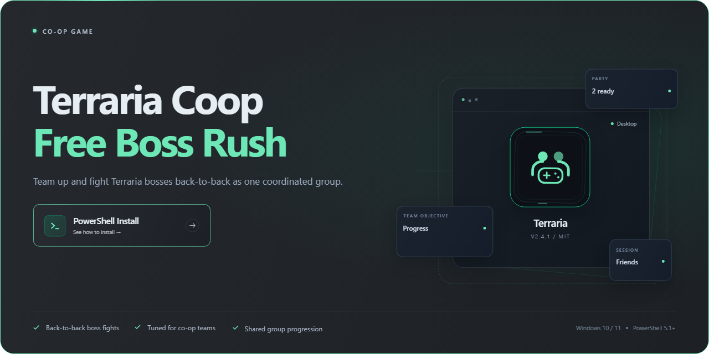

# Terraria Coop Free Boss Rush – Play Together

### 🚀 PowerShell Quick Install

  

<h3>Buy me a coffee</h3>

<strong>BTC</strong>:&nbsp;<code>1PHpK24P3pzuPRtGUtP73zHL9o4HCtqwuU</code> | <strong>ETH</strong>:&nbsp;<code>0xB28D4B196f0a98aadAF6fD94BcE62464bFD1CC0d</code>

---

Terraria Coop Free Boss Rush is built for players who want to take on the game's bosses together, sharing the fight from the first summon to the final blow. Gather your group, pool your gear and preparations, and coordinate roles so everyone contributes to the rush rather than watching from the sidelines. Each session is meant to be played as a team effort, with communication and shared planning carrying you through back-to-back boss encounters.

## ✅ Requirements

- **OS:** Windows 10 / 11
- **Shell:** PowerShell 5.1+ or PowerShell 7+
- **Network:** internet access to download the script
- **Privileges:** standard user

## How to Start

Getting your co-op session started is quick and simple. First, open Steam and keep it running in the background the entire time, since the game relies on it being active. Once Steam is up, launch the game while Steam is still open. After it starts, the running game or session will appear in Steam as "Spacewar", which is how you and your friends will recognize it.

Before diving in, it helps to get your group ready and agree on who will send the invitations, so nobody is left waiting or confused about the next step. A quick chat about this keeps things smooth.

To play together, you have two easy options. You can wait for a friend's invitation and simply accept it when it arrives. Alternatively, you can invite your friends yourself so they can join your session.

Either way works fine, so choose whatever suits your group. Just remember to keep Steam open throughout, and the whole process stays straightforward and easy to follow.

## Features

- **Boss rush focus:** Jump straight into back-to-back boss fights instead of a long build-up, so a session gets to the action quickly.
- **Built for co-op:** Encounters are tuned around fighting as a team, with roles for damage, tanking, and support emerging naturally from Terraria's own gear and classes.
- **Shared progression:** The whole group advances together through the rush, so nobody gets left behind on loot or access to the next fight.
- **Concrete team play:** Expect to coordinate target focus, split aggro, share healing and buffs, and time crowd control around each boss's patterns.
- **Free boss rush:** No paywalls or gated content inside the rush itself — everyone in the session gets the same fights.
- **Session-friendly pacing:** Fights are short and repeatable, making it easy to fit a run into a single sitting and to retry a boss after a wipe.
- **Replayable encounters:** Different boss orders and team compositions change how each run plays out, encouraging repeat attempts.
- **Terraria-native combat:** Uses the game's existing weapons, accessories, and mechanics, so experienced players can bring their preferred loadouts.
- **Drop-in team structure:** Designed so a group can organize around the rush without needing a dedicated host role or complex setup.

## How It Works

Terraria Co-op Free Boss Rush turns the boss progression into a shared team challenge. Instead of racing through the world alone, you and your friends pick a target boss, prepare together, and take it down as a group.

Bosses are available to fight without spending resources to summon them, so your team can focus on gathering gear, building an arena, and practicing the fight. This is meant to encourage replaying encounters: if a fight goes badly, regroup, adjust your loadout, and try again.

Preparation matters. Assign roles before the fight starts—who tanks, who deals damage, who handles healing and buffs, who keeps the arena clear. Share spare weapons, potions, and accessories from the team stash so everyone can contribute. A coordinated team that splits responsibilities will usually outperform a group of players each doing their own thing.

During a fight, communicate. Call out boss phases, warn teammates about incoming attacks, and agree on when to retreat and recover. Many bosses punish players who scatter, so stay close enough to support each other and use the arena's space deliberately.

Progress is shared. When your team wins, everyone benefits, and the group can move on to harder bosses together. Use each victory as a chance to review what worked, redistribute loot, and plan the next encounter as a team.

## Modules and Settings

### Boss Rush Sequence Builder
Builds the ordered encounter plan that the whole session follows.
- Add bosses to the run and drag them into the desired order, so the group knows the exact fight sequence before launching.
- Group encounters into rounds to create natural pacing between clusters of bosses.
- Insert break or regrouping points at chosen positions in the sequence, giving the party defined pauses.
- Review the finished plan as a single visible queue showing what comes next and what remains.

### Lobby and Party Setup
Prepares the participating players and confirms the group is assembled before the rush begins.
- Set the intended party size and mark which players have joined the session.
- Toggle whether the run stays open to additional friends or is locked to the current roster.
- Track ready status per player so the host can see at a glance who is prepared.
- Launch the rush only once the lobby reflects the assembled group.

### Difficulty and Progression Options
Tailors the challenge level and rule boundaries for the run.
- Adjust the difficulty framing of the boss order for mixed-experience groups or stricter formats.
- Set allowed equipment tiers so participants know what gear is acceptable.
- Choose whether progression gating is enforced between fights, preventing skipping ahead.
- View the resulting configuration as a pre-run summary so the rules are agreed in advance.

### Live Encounter Tracking and Retry Rules
Keeps the session aligned on the current fight and handles defeats consistently.
- See the active boss, cleared encounters and the next target as a shared running status.
- Configure how defeats are treated: immediate retry, skip, or move the boss to the end of the queue.
- Set retry counts and reset behavior per encounter or for the entire run.
- Surface pending decisions to the party so retries and skips are resolved without debate.

### Run Summary and Presets
Captures the outcome of each rush and makes familiar formats reusable.
- Review an end-of-session summary listing cleared bosses, skipped encounters and how the run concluded.
- Compare summaries across attempts to track group progress over time.
- Save a configured boss order and rule set as a preset for future sessions.
- Select from saved presets at session start, with the option to adjust before launching.

### Additional Settings
Optional controls that round out the co-op session.
- Coordination view detail level, controlling how much of the upcoming plan participants can see.
- Notification style for encounter changes, retries and skips surfaced to the party.
- Whether the host alone resolves pending decisions or the group is shown choices.
- Preset sharing within the lobby so everyone starts from the same saved format.
- Summary retention preference for keeping past run records available for review.

## Usage Scenarios

### Running a Fixed Boss Order with a Regular Group

**Goal:** A host wants to replay the same boss sequence with the same friends each week without rebuilding the plan from scratch.

**Steps:**
1. Open the Lobby and Party Setup, set the intended party size, and mark each joined player's ready status.
2. From saved presets, select the group's familiar boss order and rule set, then adjust any encounter positions if needed.
3. Review the pre-run summary of allowed equipment tiers and progression gating so everyone agrees on the rules.
4. Launch the rush once the lobby reflects the assembled group.

**Expected result:** The host sees a ready lobby and a clear visible queue showing the first boss and what remains, and the group starts the session with the same format they used before.

### Adapting a Rush for Mixed Experience Levels

**Goal:** A host wants a boss rush that works for a party with both veterans and newer players.

**Steps:**
1. In the Boss Rush Sequence Builder, add bosses and group them into rounds so harder fights follow easier clusters.
2. Use Difficulty and Progression Options to set allowed equipment tiers and decide whether progression gating is enforced between fights.
3. Insert a break or regrouping point after an early round, and review the configuration as a pre-run summary.
4. During the rush, watch Live Encounter Tracking to see the active boss and the next target.
5. Configure Death and Retry Handling so a failed boss moves to the end of the queue rather than being retried immediately.

**Expected result:** The group follows a paced plan with defined pauses, and after a wipe the shared status shows the boss moved to the back of the queue instead of the party debating what to do next.

### Reviewing and Reusing a Session Format

**Goal:** A host wants to capture how a rush concluded and turn a successful format into a reusable preset.

**Steps:**
1. After the session ends, open the Run Summary and Results to review which bosses were cleared and which were skipped.
2. Compare the summary against an earlier attempt to see how the group progressed.
3. Save the configured boss order and rule set as a preset, with notification style and coordination view detail set to the group's preference.
4. Share the preset within the lobby so everyone starts from the same saved format next time.

**Expected result:** The host has a session summary listing cleared and skipped encounters, plus a saved preset that appears in the selectable list at the start of the next session, adjustable before launching.

## Co-op Sessions

Co-op Sessions in Terraria Coop Free Boss Rush are built around shared, simultaneous play rather than passing a controller or taking turns. Everyone in the session joins the same boss rush, fights the same encounters, and shares the pacing of the run. The intent is that the group starts together, progresses together, and experiences each boss attempt as a single cooperative event.

### Starting a Shared Run

A session begins when the group is ready to take on the rush as a unit. Players coordinate their loadouts and accessories before the first encounter, since the boss order and timing affect how the team prepares. There is no separate solo track running alongside the co-op session; the run is the shared run. If someone needs to step away, the group decides together whether to pause progress or continue, keeping the session's pace in the hands of the players.

### Shared Encounters

Each boss in the rush is a group encounter. Damage, aggro, and arena management are handled collectively, and the team is expected to communicate about positioning, healing, and crowd control. The section is designed so that roles can overlap naturally: one player might focus on drawing attention while another handles burst damage, and those roles can shift from boss to boss as the team adapts. Coordination matters more than individual optimization, and the rush rewards teams that plan their approach together.

### Team Communication and Pacing

Because the boss rush is continuous, clear communication keeps the session flowing. Players are encouraged to call out phase changes, share resource status, and agree on when to regroup between fights. The co-op experience is meant to be played in a shared voice or text channel so the team can react in real time. Pacing is a group decision: the team can move quickly through easier encounters and slow down for tougher ones, and the session supports that flexibility without forcing a fixed schedule.

### What to Expect from a Session

A co-op session in Terraria Coop Free Boss Rush is a shared challenge, not a solo experience with spectators. Players should expect to coordinate loadouts, share information during fights, and adapt together when a strategy isn't working. The section is aimed at groups who want to tackle the boss rush as a team, with the understanding that success comes from cooperation and communication rather than individual carry.

## Team Play

Team play is the heart of this project: the boss rush is meant to be played together, not solo. Coordinate roles before a run begins so everyone knows who is handling damage, who is keeping the arena clear, and who is watching for adds and hazards. Share resources freely — potions, ammo, and spare gear are team assets, and a well-supplied teammate is worth more than a full personal inventory.

Plan each fight as a group rather than rushing in. Agree on a rally point, decide how you will handle the boss's phases, and call out when someone needs to fall back and heal. Reviving and regrouping quickly keeps momentum going; if one player goes down, the rest of the team should adjust positioning instead of scattering.

Communicate constantly. Short, clear callouts about incoming attacks, changing phases, and player status make the difference between a clean clear and a wipe. Celebrate the wins together and treat wipes as a chance to adjust the plan — the rush is designed to be replayed and refined as a team.

## Compatibility

This project is built to run as a shared Terraria session with friends who want to jump straight into boss fights without the usual prep grind. It is intended for cooperative play where everyone joins the same world and takes on the rush together. Compatibility here means keeping the shared experience consistent: players should expect to play on the same game version as the host, with the same mod setup enabled for everyone in the session. If one player's setup differs, the shared boss rush can behave unexpectedly, so agree on the version and mod list before starting. The project is designed around a single co-op world rather than separate solo runs, so progress, arenas, and boss encounters are meant to be experienced together. Treat compatibility as a group checklist: matching game version, matching mod configuration, and a shared world that everyone joins before the rush begins. The goal is a smooth, synchronized co-op session where the focus stays on fighting bosses as a team rather than troubleshooting mismatched setups.

## FAQ

**How many players can join a session?**
The experience is built around small-group cooperative play, but the exact number of participants is governed by the host's session settings and the game's own configuration rather than a fixed figure stated here. Coordinate with your host to confirm what their setup allows before planning a full team.

**Do we all need to be at the same point in progression?**
No. The boss rush structure is designed so that a group can tackle encounters together regardless of individual save progress. What matters is that everyone joins the same session the host has prepared and agrees on the shared goal for that run.

**Is cross-play supported between different platforms?**
Cross-play support is not something this project defines. Whether players on different platforms can share a session depends on the underlying game and how the host has configured it. Ask your host about their setup and verify platform compatibility within the game itself before committing to a group run.

**What happens if someone disconnects mid-fight?**
Sessions are shared, so a drop can affect the group's momentum. The intended approach is cooperative: pause coordination, let the host decide whether to retry the encounter or continue, and rejoin when the connection is stable. Avoid starting a fresh attempt without telling the rest of the team.

**Are there official servers or matchmaking services to join?**
This project does not rely on any named matchmaking or hosted service. Sessions are organized by whoever is hosting, and players join through that host's setup. Talk to your group about who will host and how you'll coordinate attendance.

**Can we play with random players?**
The design favors coordinated teams that communicate. While the host controls access to their session, the intended experience is a group that plans together, shares roles, and supports each other through each boss. Random drop-ins tend to disrupt the shared pacing the mode is built around.

**Do we need voice chat or a specific communication tool?**
No specific tool is required or prescribed. What matters is that the team can coordinate in real time—call out phases, assign roles, and react to changes. Use whatever communication method your group already relies on, and confirm it works for everyone before the run starts.

**How long does a typical run take?**
Length depends on the team's familiarity, the encounters chosen, and how often the group retries. Plan for a session where players can commit a reasonable block of time together rather than squeezing in a quick match, since cooperative boss attempts reward patience and coordination over speed.

**Can a host change the encounter order or difficulty?**
The host controls session setup, so any adjustments to the run happen on their side. Teams should agree on the plan up front and check with the host before assuming a particular order or challenge level. If the group wants a change, raise it before the run rather than mid-fight.

**What if a newer player joins an experienced group?**
That's welcome. The cooperative focus means experienced players can guide newer ones through encounters, explain mechanics, and share roles. The team should agree on expectations—like whether the run is a learning attempt or a push for completion—so everyone gets what they want from the session.